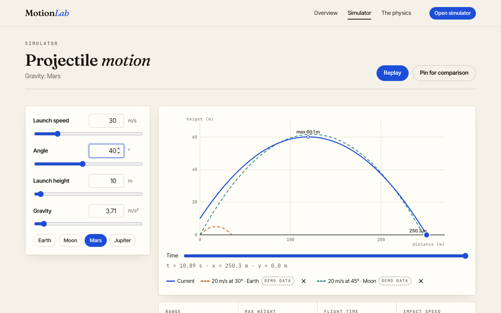
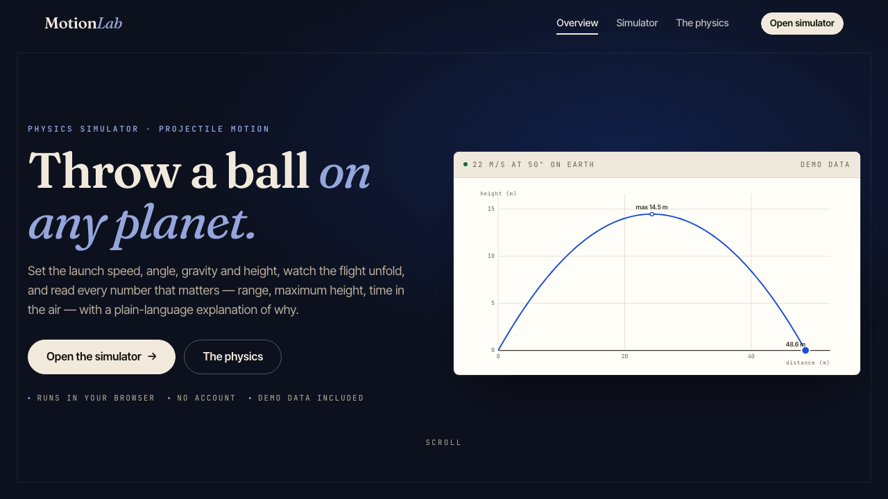
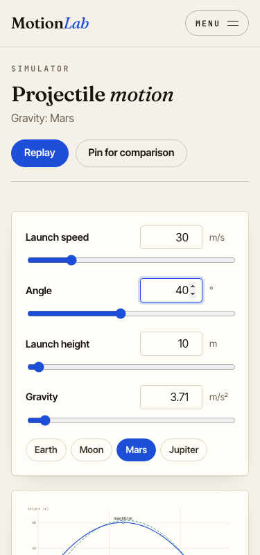

# Motion Lab

An interactive projectile-motion simulator. Change launch speed, angle, gravity (with Earth, Moon, Mars and Jupiter presets) and launch height, watch an animated, to-scale trajectory, read the calculated values, and get a plain-language explanation of what's happening.

**Live demo:** [https://kavishtolani.github.io/motion-lab/](https://kavishtolani.github.io/motion-lab/) — runs entirely in your browser; demo data is fictional and labelled.



| Landing | Mobile |
| --- | --- |
|  |  |

## Run it

```bash
npm install
npm run dev        # http://localhost:5125
npm test
npm run build
npm run test:e2e   # Playwright smoke test (npm run e2e:install once if Chromium is missing)
```

## Main workflow

1. **Simulator** — set speed (0.5–150 m/s), angle (0–90°), launch height (0–300 m) and gravity (0.5–50 m/s²) with sliders or exact numbers, or tap a planet preset. Out-of-range values show a message and the last valid launch stays on screen.
2. **Play / Replay** animates the flight (any flight takes about four seconds on screen); **Time** scrubs to any moment and shows t, x and y.
3. The plot has labelled metre axes, a dashed full path, the traced path, an apex marker and a range label.
4. Results: range, maximum height, flight time, impact speed, time to peak and impact angle, plus a step-by-step explanation (horizontal vs vertical motion, how gravity stops the rise, complementary angles, 45° from ground level).
5. **Pin for comparison** keeps up to three earlier throws as dashed curves with a legend. Two labelled demo comparisons are shown at first.
6. **The physics** lists the equations and assumptions.

## Tests

- `src/lib/physics.test.ts` — textbook range/height/time at 45°, complementary angles, horizontal launch from height, trajectory endpoints, validation, explanation wording.
- `src/App.test.tsx` — default results and accessible chart label, Moon preset, invalid input keeping the last valid result, time scrubbing, pin limits.
- `e2e/smoke.spec.ts` — change inputs, run the animation to completion, Mars preset, validation, reload persistence; strict 375px checks.

## Limitations

- Idealised model: no air resistance, wind, spin, or curved ground; the projectile is a point.
- Landing is always at height 0 (no targets or terrain).
- Animation is time-scaled for viewing, not real time; with reduced motion it doesn't autoplay.

## Future improvements

- Optional linear/quadratic drag with a comparison to the ideal curve; a target to hit; exporting trajectory data as CSV.

## Licence

MIT — see [LICENSE](LICENSE).
